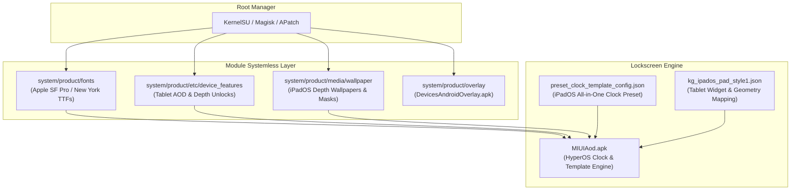

# 🍎 iPadOS Lockscreen for HyperOS (Tablet Edition)

[](https://en.wikipedia.org/wiki/Xiaomi_HyperOS)
[](#supported-devices)
[](#installation)
[](LICENSE)

An open-source, systemless modification that transforms the **Xiaomi / Redmi Tablet Lockscreen & Always-On Display** into an authentic **iPadOS-inspired experience** across **Xiaomi HyperOS 3, HyperOS 2, and HyperOS 4**.

Specifically tuned and verified for the **Redmi Pad Pro 5G / POCO Pad 5G (`ruan`)**, **Redmi Pad Pro Wi-Fi (`dizi`)**, and the **Xiaomi Pad series**.

---

## ✨ Features

- **Apple SF Pro Typography**: Replaces lockscreen clock numerals with real **SF Pro Rounded Bold**, **SF Pro Text**, and **New York Serif**.
- **iPadOS Centered Clock**: Large proportional clock layout with date header placed cleanly above the time (`SATURDAY, 21 NOVEMBER` format).
- **Depth Effect Wallpapers**: Dual-layer subject segmentation with pre-rendered depth masks (`_mask.jpg`) allowing the clock to pass behind wallpaper subjects naturally.
- **Horizontal Tablet Widget Shelf**: Tailored for 16:10 and 4:3 tablet screens, positioning battery rings, weather summaries, and calendar cards beneath the clock.
- **Cross-Version Architecture**: Compatible with **HyperOS 3.0** (native), with graceful fallback support for **HyperOS 2.0** and forward compatibility for **HyperOS 4.0**.
- **Signature Verification Bypassed**: Fully compatible with CorePatch and LSPosed frameworks.

---

## 📱 Supported Devices & Versions

| Target | Codename | OS Versions | Status |
| :--- | :--- | :--- | :--- |
| **Redmi Pad Pro 5G / POCO Pad 5G** | `ruan` | HyperOS 3.0 (Android 16), HOS 2.0 | **Primary Verified** ✅ |
| **Redmi Pad Pro (Wi-Fi)** | `dizi` | HyperOS 3.0, HOS 2.0 | Compatible ✅ |
| **Xiaomi Pad 6 / 6 Pro / 6S Pro** | `pipa`, `liuqin`, `sheng` | HyperOS 1.0 - 3.0 | Compatible ✅ |
| **Redmi Pad SE 8.7** | `xun` | HyperOS 2.0, 3.0 | Compatible ✅ |
| **HyperOS Phones** | All | HyperOS 2.0 - 4.0 | Supported via auto-layout fallback |

---

## 🛠️ Architecture Overview



---

## 🚀 Installation

### Prerequisites
1. Rooted with **KernelSU**, **Magisk**, or **APatch**.
2. **Signature Verification Disabled** (via [CorePatch](https://github.com/LSPosed/CorePatch) LSPosed module or DisableApkVerification).

### Flashing Guide
1. Download the latest release from the [Releases](https://github.com/spider-man4u/iPadOS-Lockscreen-HyperOS/releases) tab (or build it locally using `tools/build_module.py`).
2. Open **KernelSU** or **Magisk**.
3. Navigate to **Modules** → **Install from storage**.
4. Select `iPadOS_Lockscreen_HyperOS_v1.0.zip`.
5. Reboot your device.

---

## 🧰 Developer Tools & Custom Builds

All build and patching tools are written in standard Python 3 and can run directly on Termux on the tablet itself:

```bash
# 1. Package the flashable module ZIP
python3 tools/build_module.py

# 2. Patch a custom MIUIAod.apk with iPadOS templates
python3 tools/patch_aod.py /path/to/MIUIAod.apk /path/to/output_MIUIAod.apk
```

---

## 🤝 Credits & Acknowledgements

- **Spider** ([@spider-man4u](https://github.com/spider-man4u)) — Creator & HyperOS tablet maintainer
- **Antigravity** — System architecture & Python automated toolchain
- **Mods Center & Kashi** — Foundation AOD research & unlocking techniques
- **BlassGO** — Dynamic Installer framework
- **Apple Inc.** — Design inspiration (iPadOS Lockscreen UI & SF Pro typography)

---

## 📄 License

Licensed under the [Apache License, Version 2.0](LICENSE).
