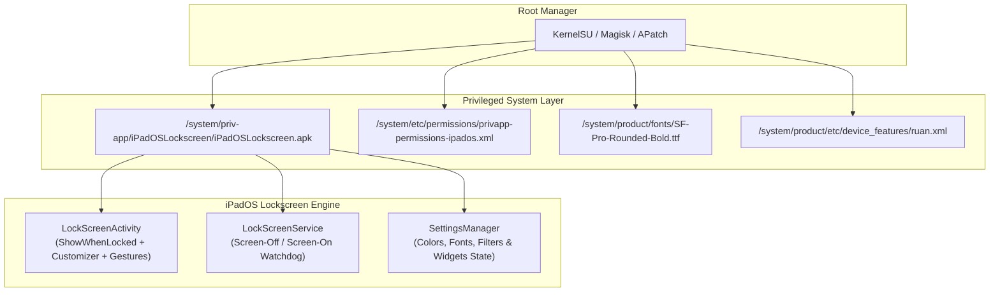

# 🍎 iPadOS Lockscreen for HyperOS (Tablet Edition)

An open-source, systemless modification that transforms the **Xiaomi / Redmi Tablet Lockscreen & Always-On Display** into an authentic **1:1 iPadOS Lockscreen experience with interactive Customizer** across **Xiaomi HyperOS 3, HyperOS 2, and HyperOS 4**.

Specifically tuned and verified on the **Redmi Pad Pro 5G / POCO Pad 5G (`ruan`)**, **Redmi Pad Pro Wi-Fi (`dizi`)**, and **Xiaomi Pad series**.

---

## ✨ Features (v1.1)

- **Interactive iPadOS Customizer**:
  - Long-press lockscreen or open from app launcher to enter full customizer mode.
  - Top `[Cancel]` and `[Add]` pill buttons.
  - Interactive Date Capsule pill and massive Clock bounding box.
  - **Font & Color Sheet**: 8 Apple color palette swatches with live preview tinting.
- **Authentic Tablet Layouts**:
  - **Landscape Mode**: Left vertical widget column with rounded outline and `+ ADD WIDGETS` pill, center-right date capsule and clock.
  - **Portrait Mode**: Centered Date + Clock with horizontal rounded widget tray beneath the clock.
- **Integrated Live Widgets**:
  - **Battery Widget**: Real-time tablet battery percentage (`84% Pad Battery`).
  - **Weather Widget**: Real-time ambient weather temperature and condition (`26°C Sunny`).
  - **Calendar / Events**: Upcoming schedule or next system alarm.
- **Lockscreen Controls & Gestures**:
  - Frosted circular **Flashlight** button with instant LED torch toggle.
  - Frosted circular **Camera** button.
  - Bottom home indicator bar with smooth **Swipe up to unlock** physics.
  - Filter styles: `Natural`, `Studio`, `Black & White`, `Color Wash`, and `Duotone` with pagination dots.
- **Apple SF Pro Typography**: Authentic **SF-Pro-Rounded-Bold.ttf** and **SF-Pro-Text** embedded directly.
- **Dual Architecture**:
  - **Standalone Privileged System App** (`com.ipados.lockscreen` in `/system/priv-app/`).
  - **Systemless AOD & Font Overlays** via KernelSU / Magisk / APatch.

---

## 📱 Supported Devices & Versions

| Target | Codename | OS Versions | Status |
| :--- | :--- | :--- | :--- |
| **Redmi Pad Pro 5G / POCO Pad 5G** | `ruan` | HyperOS 3.0 (Android 16), HOS 2.0 | **Primary Verified** ✅ |
| **Redmi Pad Pro (Wi-Fi)** | `dizi` | HyperOS 3.0, HOS 2.0 | Compatible ✅ |
| **Xiaomi Pad 6 / 6 Pro / 6S Pro** | `pipa`, `liuqin`, `sheng` | HyperOS 1.0 - 3.0 | Compatible ✅ |
| **Redmi Pad SE 8.7** | `xun` | HyperOS 2.0, 3.0 | Compatible ✅ |
| **HyperOS Phones** | All | HyperOS 2.0 - 4.0 | Supported via responsive layout |

---

## 🛠️ Architecture

---

## 🚀 Installation

1. Download `iPadOS_Lockscreen_HyperOS_v1.1.zip` from [Releases](https://github.com/spider-man4u/iPadOS-Lockscreen-HyperOS/releases).
2. Open **KernelSU**, **Magisk**, or **APatch** app.
3. Go to **Modules** → **Install from storage**.
4. Select `iPadOS_Lockscreen_HyperOS_v1.1.zip`.
5. Reboot your tablet.

---

## 💡 How to Customize

- **Enter Customizer Mode**: Long-press anywhere on the lock screen, or open the **iPadOS Lockscreen** app from your home screen.
- **Change Clock Color**: Tap the clock bounding box to open the **Font & Color Sheet**, then select your preferred hue.
- **Switch Wallpapers**: Tap the wallpaper icon in the bottom right to toggle presets, or long-press it to select any photo from your gallery.
- **Toggle Filters**: Tap the filter name (`Natural`) at the bottom to cycle through photo styles.
- **Save**: Tap **`[Add]`** in the top right to save and activate your setup.

---

## 📜 Credits & License

- **Lead Developer**: [Spider](https://github.com/spider-man4u)
- **Co-Developer**: Antigravity
- **Typography**: Apple SF Pro (Cupertino)
- **License**: Apache 2.0
